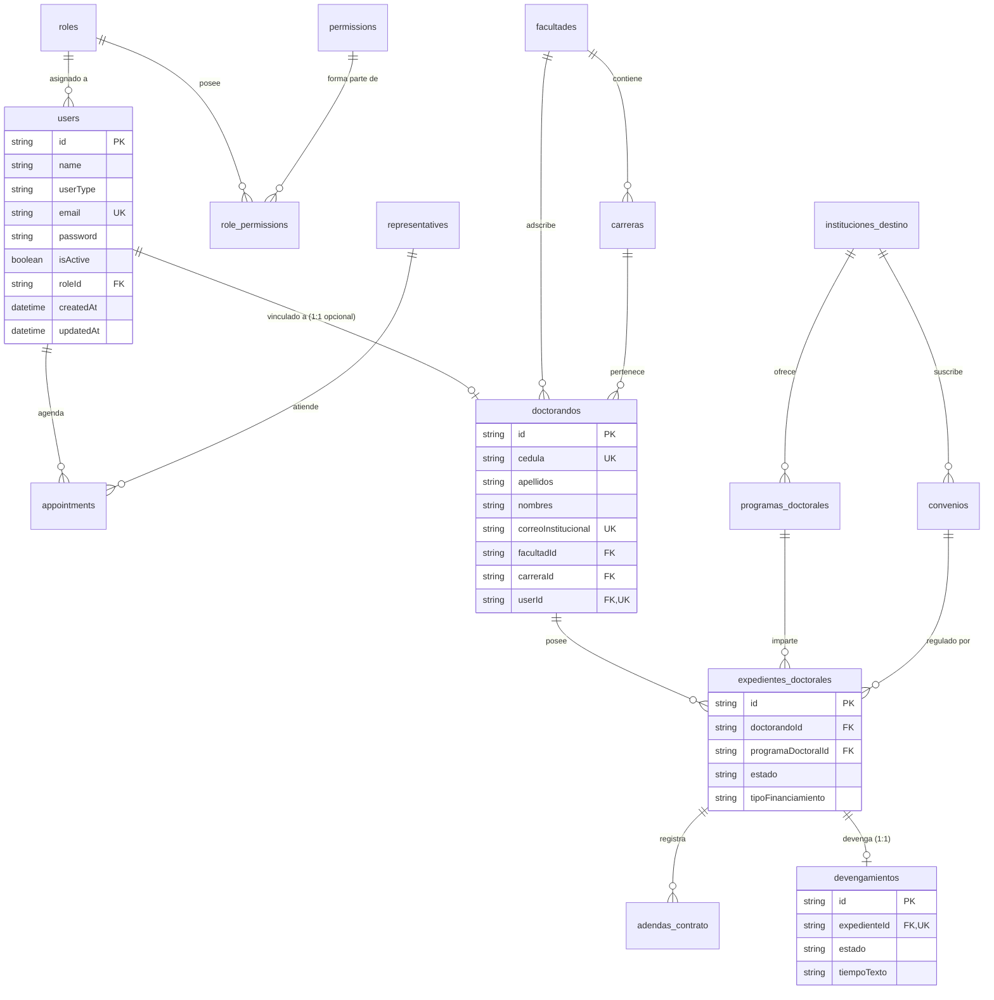

# 🏛️ 01 - Arquitectura y Base de Datos

Este documento detalla la estructura técnica de la aplicación backend, la configuración de variables de entorno, la arquitectura de enrutamiento y el modelo relacional implementado en **Neon PostgreSQL** mediante **Prisma ORM**.

---

## 🏗️ Flujo de Arquitectura y Enrutamiento

El sistema utiliza un patrón estructurado en capas para APIs RESTful con middleware de seguridad y flexibilidad de prefijos para garantizar compatibilidad con múltiples clientes frontend (Next.js Admin y Astro Usuario).

```text
  [Cliente Frontend: Next.js / Astro]
                  │
                  │ HTTP Request (Bearer JWT Token)
                  ▼
         [Express Server (server.ts)]
                  │
                  ├──> CORS (orígenes dinámicos autorizados) & JSON Parser
                  ├──> Health Check (/ & /health)
                  │
                  ├──> Router Layer (routes/*.routes.ts)
                  │       │
                  │       ├──> Prefijo Dual: (/api/* y /*)
                  │       ├──> Alias: (/personal-ugd, /citas, /reservas, /labs)
                  │       │
                  │       ├──> Auth Middleware (authenticateToken)
                  │       └──> RBAC Middleware (checkPermission / requireRole)
                  │
                  ├──> Controller Layer (controllers/*.controller.ts)
                  │       │
                  │       └──> Prisma Client Singleton (lib/prisma.ts)
                  │
                  ▼
  [Neon PostgreSQL Database] (AWS sa-east-1)
```

---

## ⚙️ Variables de Entorno (`.env`)

Ubicación: `express-backend-api/.env`

| Variable | Descripción | Ejemplo / Valor por Defecto |
| -------- | ----------- | --------------------------- |
| `DATABASE_URL` | String de conexión JDBC/PostgreSQL a Neon DB | `postgresql://neondb_owner:npg_...-pooler.sa-east-1.aws.neon.tech/neondb?sslmode=require` |
| `PORT` | Puerto de escucha del servidor Express | `3000` |
| `JWT_SECRET` | Clave secreta para firmar y verificar JWT | `"super-secret-jwt-key-proyecto-integrador-ugd-2026"` |
| `JWT_EXPIRES_IN` | Tiempo de expiración de los tokens emitidos | `"24h"` |
| `CORS_ORIGIN` | Lista separada por comas de orígenes permitidos | `http://localhost:4321,http://localhost:3000,http://localhost:3001` |

> ⚠️ **Nota de Seguridad**: El archivo `.env` contiene credenciales sensibles y se encuentra excluido del control de versiones (`.gitignore`).

---

## 🗄️ Modelo de Datos Relacional (Prisma Schema)

Ubicación: `express-backend-api/prisma/schema.prisma`

La base de datos relacional almacena el sistema de permisos RBAC, la información de usuarios, el catálogo de representantes UGD, el registro de citas presenciales, los ajustes dinámicos y todo el **dominio académico oficial de la UGD** (doctorandos, expedientes doctorales, devengamientos, facultades y carreras).

### Diagrama de Relaciones ER (Mermaid)



---

## 📋 Descripción de Tablas

### Módulo A: Sistema Base, Autenticación y Citas

#### 1. Tabla `roles` (`@@map("roles")`)
Almacena los roles disponibles en el sistema RBAC.

| Campo | Tipo | Restricciones | Descripción |
| ----- | ---- | ------------- | ----------- |
| `id` | `String` | `@id`, UUID | Identificador único del rol. |
| `code` | `String` | `@unique` | Código funcional (`DESARROLLADOR`, `DIRECTOR`, `ANALISTA_PROCESOS`, `ANALISTA_TECNICO`, `ESTUDIANTE`). |
| `name` | `String` | Requerido | Nombre legible del rol. |
| `description` | `String` | Opcional | Descripción funcional del rol. |
| `createdAt` | `DateTime` | `@default(now())` | Fecha de creación. |
| `updatedAt` | `DateTime` | `@updatedAt` | Fecha de actualización. |

#### 2. Tabla `permissions` (`@@map("permissions")`)
Almacena el catálogo de permisos atómicos del sistema.

| Campo | Tipo | Restricciones | Descripción |
| ----- | ---- | ------------- | ----------- |
| `id` | `String` | `@id`, UUID | Identificador único del permiso. |
| `code` | `String` | `@unique` | Código del permiso (ej. `USUARIOS_VER`, `PROCESOS_CREAR`). |
| `name` | `String` | Requerido | Nombre legible del permiso. |
| `description` | `String` | Opcional | Detalle funcional. |
| `category` | `String` | Opcional | Categoría de agrupación. |

#### 3. Tabla `role_permissions` (`@@map("role_permissions")`)
Tabla intermedia de relación muchos a muchos entre `roles` y `permissions`.

| Campo | Tipo | Restricciones | Descripción |
| ----- | ---- | ------------- | ----------- |
| `roleId` | `String` | FK -> `roles.id` | ID del rol. |
| `permissionId` | `String` | FK -> `permissions.id` | ID del permiso. |
| `assignedAt` | `DateTime` | `@default(now())` | Fecha de asignación. |

#### 4. Tabla `users` (`@@map("users")`)
Almacena las cuentas de usuario y credenciales activas en la plataforma.

| Campo | Tipo | Restricciones | Descripción |
| ----- | ---- | ------------- | ----------- |
| `id` | `String` | `@id`, UUID | Identificador único del usuario. |
| `name` | `String` | Requerido | Nombre completo del usuario. |
| `userType` | `String` | Requerido | Tipo de perfil ("Personal UGD", "Estudiante", "Personal técnico"). |
| `email` | `String` | `@unique` | Correo institucional único. |
| `password` | `String` | Requerido | Hash bcrypt de la contraseña. |
| `isActive` | `Boolean` | `@default(true)` | Estado activo/inactivo de la cuenta. |
| `roleId` | `String` | FK -> `roles.id` | ID del rol asignado. |

#### 5. Tabla `representatives` (`@@map("representatives")`)
Almacena la información de los analistas / representantes UGD disponibles para atención presencial.

| Campo | Tipo | Restricciones | Descripción |
| ----- | ---- | ------------- | ----------- |
| `id` | `Int` | `@id`, AutoIncrement | ID numérico único del representante. |
| `name` | `String` | Requerido | Nombre completo del representante. |
| `title` | `String` | `@default("Analista UGD")` | Cargo o título funcional. |
| `location` | `String` | `@default("Unidad de Gestión de Doctorados")` | Ubicación / Oficina de atención presencial. |
| `capacity` | `Int` | `@default(1)` | Capacidad máxima simultánea de atención. |
| `status` | `String` | `@default("activo")` | Estado del representante (`activo` / `inactivo`). |

#### 6. Tabla `appointments` (`@@map("appointments")`)
Almacena las citas presenciales reservadas por los estudiantes.

| Campo | Tipo | Restricciones | Descripción |
| ----- | ---- | ------------- | ----------- |
| `id` | `Int` | `@id`, AutoIncrement | ID numérico único de la cita. |
| `representativeId` | `Int` | FK -> `representatives.id` | ID del representante asignado. |
| `userId` | `String` | FK -> `users.id` | ID del estudiante que reservó. |
| `date` | `String` | Requerido | Fecha de la cita en formato `YYYY-MM-DD`. |
| `startTime` | `String` | `@default("08:00")` | Franja horaria de inicio (ej. `"08:30"`). |
| `startHour` | `Int` | `@default(8)` | Hora en formato entero (ej. `8`). |
| `subject` | `String` | Requerido | Motivo o materia objeto de la cita presencial. |
| `status` | `String` | `@default("activa")` | Estado persistido de la cita (`activa` / `cancelada`). |

- **Restricción de Unicidad**: `@@unique([representativeId, date, startTime])` que evita colisiones de citas con el mismo representante en el mismo horario.

#### 7. Tabla `system_settings` (`@@map("system_settings")`)
Almacena parámetros de configuración dinamizables en tiempo real.

| Campo | Tipo | Restricciones | Descripción |
| ----- | ---- | ------------- | ----------- |
| `id` | `String` | `@id`, UUID | ID único de la configuración. |
| `key` | `String` | `@unique` | Clave identificadora (ej. `system_status`, `max_turns_per_day`). |
| `value` | `String` | Requerido | Valor almacenado en formato texto. |
| `description` | `String` | Opcional | Descripción del propósito del parámetro. |

---

### Módulo B: Dominio Académico Oficial UGD

#### 8. Tabla `facultades` (`@@map("facultades")`)
Catálogo oficial de facultades de la Universidad Central del Ecuador.
- `id` (PK), `nombre` (UNIQUE), `codigo` (UNIQUE, opcional).

#### 9. Tabla `carreras` (`@@map("carreras")`)
Carreras o escuelas adscritas a cada facultad.
- `id` (PK), `nombre`, `facultadId` (FK -> `facultades.id`). Restricción `@@unique([facultadId, nombre])`.

#### 10. Tabla `instituciones_destino` (`@@map("instituciones_destino")`)
Universidades e instituciones nacionales e internacionales donde los doctorandos realizan sus programas.
- `id` (PK), `nombre` (UNIQUE), `pais`.

#### 11. Tabla `programas_doctorales` (`@@map("programas_doctorales")`)
Oferta de programas de doctorado asociados a las instituciones de destino.
- `id` (PK), `nombre`, `tituloAObtener`, `institucionDestinoId` (FK). Restricción `@@unique([institucionDestinoId, nombre])`.

#### 12. Tabla `convenios` (`@@map("convenios")`)
Convenios interinstitucionales de financiamiento y cooperación académica.
- `id` (PK), `nombre` (UNIQUE), `fechaInicio`, `fechaFin`, `institucionDestinoId` (FK, opcional).

#### 13. Tabla `doctorandos` (`@@map("doctorandos")`)
Padrón oficial de estudiantes doctorandos de la UGD.
- `id` (PK), `carpeta`, `numeroOrden`, `cedula` (UNIQUE), `apellidos`, `nombres`, `sexo`, `fechaNacimiento`, `correoInstitucional` (UNIQUE), `telefono`, `tituloTercerNivel`, `tituloCuartoNivel`, `facultadId` (FK), `carreraId` (FK), `userId` (FK -> `users.id`, UNIQUE, opcional).
- **Relación con `users`**: Permite vincular la identidad digital activa del estudiante (`User`) con su expediente académico oficial (`Doctorando`).

#### 14. Tabla `expedientes_doctorales` (`@@map("expedientes_doctorales")`)
Expediente académico, de beca y contractual de cada doctorando.
- `id` (PK), `doctorandoId` (FK), `programaDoctoralId` (FK), `convenioId` (FK, opcional), `tituloInvestigacion`, `oficioRegistroProyecto`, `fechaOficioRegistro`, `tipoFinanciamiento`, `tieneApoyoProyecto`, `contratoInicio`, `contratoFin`, `contratoMeses`, `estado` (`EN_ESTUDIOS`, `GRADUADO`, `EN_DEVENGAMIENTO`, `DEVENGADO`, etc.), `observaciones`, `tieneAlertaLegal`, `historialInformes`.

#### 15. Tabla `adendas_contrato` (`@@map("adendas_contrato")`)
Adendas y modificaciones a los contratos de beca o financiamiento.
- `id` (PK), `expedienteId` (FK), `numeroAdenda`, `fechaInicio`, `fechaFin`, `meses`, `tipoModificacion`. Restricción `@@unique([expedienteId, numeroAdenda])`.

#### 16. Tabla `devengamientos` (`@@map("devengamientos")`)
Seguimiento al compromiso de devengamiento institucional de los doctorandos graduados o beneficiarios de beca.
- `id` (PK), `expedienteId` (FK, UNIQUE), `fechaInicio`, `tiempoTexto`, `fechaFinEstimada`, `oficioNotificacion`, `oficioActaTerminacion`, `oficioCierreProyecto`, `registroSenescyt`, `estado` (`PENDIENTE`, `EN_CURSO`, `FINALIZADO`).

---

## 🔧 Conexión a Neon PostgreSQL

La base de datos PostgreSQL se hospeda en la nube de **NeonTech** en la región `aws-sa-east-1` (São Paulo, Sudamérica). La conexión implementa **Connection Pooling** y cifrado obligatorio TLS/SSL (`sslmode=require`).
