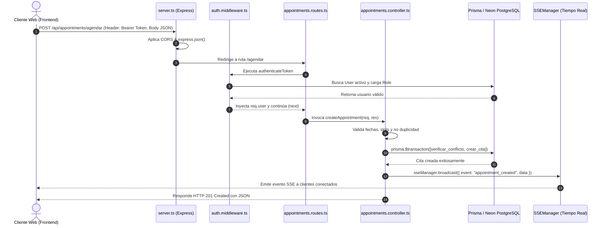

Este documento describe la estructura modular del sistema de archivos del repositorio `express-backend-api`, las responsabilidades de cada capa técnica y los patrones recomendados para que nuevos desarrolladores extiendan el backend de forma escalable y ordenada.

---

## 1. Árbol de Directorios del Proyecto

El código fuente sigue un patrón de arquitectura por capas desacopladas:

```text
express-backend-api/
├── .env                       # Variables de entorno locales (DATABASE_URL, JWT_SECRET, etc.)
├── .gitignore                 # Exclusiones de Git (node_modules, .env, dist)
├── bun.lock                   # Lockfile determinista de paquetes de Bun
├── package.json               # Dependencias, scripts de ejecución y metadatos
├── tsconfig.json              # Configuración de compilación de TypeScript (ESNext, NodeNext)
│
├── prisma/                    # Capa de datos y persistencia relacional
│   ├── schema.prisma          # Esquema declarativo unificado (16 modelos Prisma)
│   ├── seed.ts                # Sembrado del sistema base: roles, permisos, usuarios y analistas
│   ├── seed-doctorandos.ts    # Sembrado masivo del padrón oficial UCE (lotes concurrentes)
│   └── data/
│       └── import_neon_doctorandos.sql # Script SQL oficial con más de 550 doctorandos
│
├── src/                       # Código fuente de la aplicación
│   ├── server.ts              # Instancia de Express, middlewares globales, rutas y health check
│   │
│   ├── lib/                   # Clientes compartidos y módulos singleton
│   │   ├── prisma.ts          # Instancia única de PrismaClient (Connection Pooling)
│   │   └── sse.ts             # Gestor en memoria de Server-Sent Events (SSEManager)
│   │
│   ├── middleware/            # Middlewares de seguridad e interceptación HTTP
│   │   └── auth.middleware.ts # authenticateToken, requireRole y checkPermission
│   │
│   ├── controllers/           # Capa de controladores y lógica de negocio
│   │   ├── appointments.controller.ts    # Agendamiento, cálculo de estados y cancelaciones
│   │   ├── auth.controller.ts            # Login, admin-login, activación y perfil 360°
│   │   ├── representatives.controller.ts # Gestión de analistas y disponibilidad de slots
│   │   └── settings.controller.ts        # Parámetros llave-valor y generación de backups
│   │
│   └── routes/                # Capa de definición y exposición de rutas HTTP
│       ├── appointments.routes.ts        # Endpoints de citas (/appointments, /citas, /reservas)
│       ├── auth.routes.ts                # Endpoints de autenticación (/auth)
│       ├── procesos.routes.ts            # Endpoints de procesos universitarios (/procesos)
│       ├── representatives.routes.ts     # Endpoints de personal UGD (/representatives, /personal-ugd)
│       ├── settings.routes.ts            # Endpoints de ajustes (/settings)
│       ├── tecnico.routes.ts             # Endpoints de diagnóstico técnico (/tecnico)
│       └── users.routes.ts               # Endpoints de gestión de usuarios (/users)
│
└── docu/                      # Documentación técnica interna en Markdown
    ├── 01-arquitectura-y-bd.md
    ├── 02-matriz-rbac-y-usuarios.md
    ├── 03-mapeo-endpoints-api.md
    ├── 04-guia-de-pruebas.md
    ├── 05-modulo-citas-y-representantes.md
    └── 06-modulo-configuracion-y-backups.md
```

---

## 2. Responsabilidades por Capa

### 2.1 Capa de Enrutamiento (`src/routes/`)
- Define los verbos HTTP (`GET`, `POST`, `PUT`, `PATCH`, `DELETE`) y las rutas URL asociadas.
- Aplica los middlewares de seguridad requeridos (`authenticateToken`, `requireRole`, `checkPermission`).
- No contiene lógica de negocio ni consultas directas a base de datos; delega inmediatamente a los controladores correspondientes.

### 2.2 Capa de Controladores (`src/controllers/`)
- Recibe los objetos `Request` y `Response` de Express.
- Valida los parámetros entrantes (`req.params`, `req.query`, `req.body`).
- Orquesta las operaciones de negocio interactuando con la base de datos a través de `prisma`.
- Emite notificaciones reactivas en tiempo real mediante `sseManager` cuando ocurren mutaciones de estado (ej. reserva cancelada o agendada).
- Retorna respuestas JSON estandarizadas con códigos de estado HTTP semánticos (200, 201, 400, 401, 403, 404, 409, 500).

### 2.3 Capa de Middlewares (`src/middleware/`)
- Intercepta las solicitudes entrantes antes de que alcancen a los controladores.
- `authenticateToken`: Extrae el token JWT (de cabecera `Authorization: Bearer <token>` o query param `?token=`), verifica su firma simétrica y consulta en base de datos la vigencia del usuario (`isActive: true`). Inyecta `req.user`.
- `requireRole`: Verifica que el código de rol del usuario pertenezca a la lista autorizada para la ruta administrativa.
- `checkPermission`: Consulta en la tabla `role_permissions` si el rol del usuario posee asignado el permiso granular solicitado.

### 2.4 Capa de Librerías y Singletons (`src/lib/`)
- `prisma.ts`: Exporta una única instancia de `PrismaClient` compartida en toda la aplicación, evitando fugas de memoria o múltiples conexiones durante recargas en caliente.
- `sse.ts`: Exporta `sseManager`, un gestor en memoria que administra las conexiones activas de Server-Sent Events, el filtrado por roles y el envío de mensajes `keep-alive`.

### 2.5 Capa de Persistencia y Sembrado (`prisma/`)
- `schema.prisma`: Define los 16 modelos relacionales de PostgreSQL con sus atributos, tipos, restricciones `@@unique` e índices.
- `seed.ts`: Inicializa roles base, catálogo de 15 permisos, matriz RBAC, usuarios de prueba (desarrollador Dennis y director Freddy), representantes UGD y parámetros por defecto.
- `seed-doctorandos.ts`: Procesa la nómina real de la UCE en lotes concurrentes (10 lotes paralelos) importando doctorandos, facultades y carreras.

---

## 3. Ciclo de Vida de una Petición (Request Lifecycle)

El siguiente flujo ilustra el recorrido de una solicitud HTTP típica (por ejemplo, `POST /api/appointments/agendar`):



---

## 4. Guía para Extender el Backend

Para añadir una nueva funcionalidad al backend (por ejemplo, un módulo de auditoría de trámites), sigue esta metodología:

### Paso 1: Definir el Modelo en Prisma
Añade el modelo en `prisma/schema.prisma` y sincroniza la base de datos:
```prisma
model TramiteAuditoria {
  id        String   @id @default(uuid())
  accion    String
  detalle   String?
  userId    String
  user      User     @relation(fields: [userId], references: [id])
  createdAt DateTime @default(now())

  @@map("tramites_auditoria")
}
```
Ejecuta la sincronización:
```bash
bun run db:push
```

### Paso 2: Crear el Controlador
Crea `src/controllers/auditoria.controller.ts`:
```typescript
import { Request, Response } from "express";
import { prisma } from "../lib/prisma";

export async function getAuditoriaLogs(req: Request, res: Response) {
  try {
    const logs = await prisma.tramiteAuditoria.findMany({
      orderBy: { createdAt: "desc" },
      take: 50,
    });
    return res.json(logs);
  } catch (error) {
    return res.status(500).json({ error: "Error al consultar auditoría" });
  }
}
```

### Paso 3: Crear el Archivo de Rutas
Crea `src/routes/auditoria.routes.ts` aplicando la seguridad RBAC requerida:
```typescript
import { Router } from "express";
import { getAuditoriaLogs } from "../controllers/auditoria.controller";
import { authenticateToken, requireRole } from "../middleware/auth.middleware";

const router = Router();
router.get("/", authenticateToken, requireRole("DESARROLLADOR", "DIRECTOR"), getAuditoriaLogs);

export default router;
```

### Paso 4: Registrar en `server.ts` con Rutas Duales
En `src/server.ts`, importa y monta las rutas con prefijo dual:
```typescript
import auditoriaRoutes from "./routes/auditoria.routes";

// Montaje dual
app.use("/api/auditoria", auditoriaRoutes);
app.use("/auditoria", auditoriaRoutes);
```
