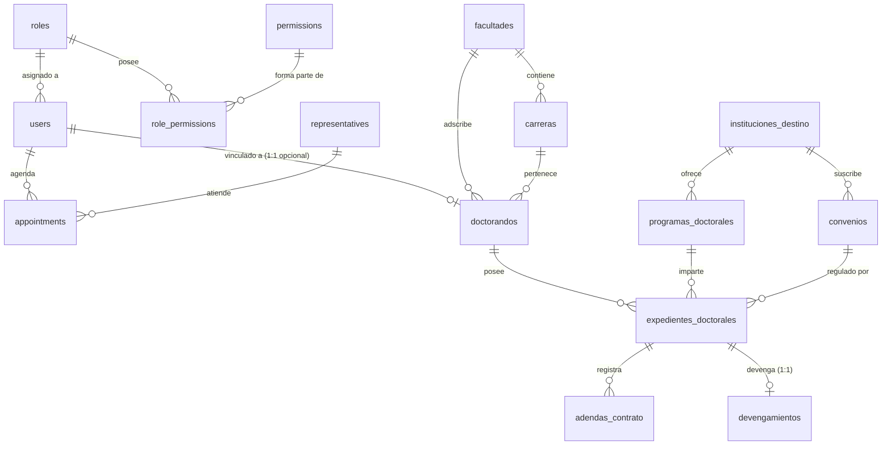

Este documento describe la totalidad del modelo relacional definido en [prisma/schema.prisma](file:///D:/GitHub/Proyecto-Integrador/express-backend-api/prisma/schema.prisma). Está compuesto por **16 modelos relacionales** organizados en tres dominios fundamentales: **Seguridad y Control de Acceso (RBAC)**, **Citas y Atención Presencial** y el **Dominio Académico de Doctorados de la UCE**.

---

## 1. Diagrama Entidad-Relación Global



---

## 2. Dominio 1: Seguridad y Control de Acceso (RBAC)

Este dominio gobierna las cuentas de usuario, sus roles y los permisos atómicos asignados en base de datos.

### 2.1 Modelo: `Role` (`@@map("roles")`)
Representa los roles jerárquicos del sistema.

<ModelTable title="Catálogo de Roles" tableName="roles">
  <ModelField name="id" type="String (UUID)" isPrimary={true} defaultValue="uuid()">
    Identificador único universal del rol.
  </ModelField>
  <ModelField name="code" type="String" isUnique={true}>
    Código programático en mayúsculas: `DESARROLLADOR`, `DIRECTOR`, `ANALISTA_PROCESOS`, `ANALISTA_TECNICO`, `ESTUDIANTE`.
  </ModelField>
  <ModelField name="name" type="String">
    Nombre legible del rol en la interfaz (ej: "Director de Doctorados").
  </ModelField>
  <ModelField name="description" type="String" isNullable={true}>
    Descripción de los alcances operativos del rol.
  </ModelField>
  <ModelField name="createdAt" type="DateTime" defaultValue="now()">
    Fecha y hora de creación del registro.
  </ModelField>
  <ModelField name="updatedAt" type="DateTime" defaultValue="updatedAt">
    Fecha de última modificación.
  </ModelField>
</ModelTable>

---

### 2.2 Modelo: `Permission` (`@@map("permissions")`)
Catálogo de permisos atómicos del sistema evaluados por el middleware `checkPermission`.

<ModelTable title="Catálogo de Permisos" tableName="permissions">
  <ModelField name="id" type="String (UUID)" isPrimary={true} defaultValue="uuid()">
    Identificador único universal del permiso.
  </ModelField>
  <ModelField name="code" type="String" isUnique={true}>
    Identificador único del permiso (ej: `USUARIOS_VER`, `USUARIOS_CREAR`, `PROCESOS_VER`).
  </ModelField>
  <ModelField name="name" type="String">
    Etiqueta descriptiva del permiso.
  </ModelField>
  <ModelField name="description" type="String" isNullable={true}>
    Detalle funcional de la acción que autoriza.
  </ModelField>
  <ModelField name="category" type="String" isNullable={true}>
    Módulo de agrupación (ej: "Usuarios", "Procesos", "Estudiantes", "Configuración", "Técnico").
  </ModelField>
</ModelTable>

---

### 2.3 Modelo: `RolePermission` (`@@map("role_permissions")`)
Tabla intermedia que materializa la relación muchos a muchos entre roles y permisos.

<ModelTable title="Asignación Rol-Permiso" tableName="role_permissions">
  <ModelField name="roleId" type="String (UUID)" isPrimary={true} isForeign={true}>
    FK hacia `roles.id` con eliminación en cascada (`onDelete: Cascade`).
  </ModelField>
  <ModelField name="permissionId" type="String (UUID)" isPrimary={true} isForeign={true}>
    FK hacia `permissions.id` con eliminación en cascada (`onDelete: Cascade`).
  </ModelField>
  <ModelField name="assignedAt" type="DateTime" defaultValue="now()">
    Estampa de tiempo de la concesión del permiso.
  </ModelField>
</ModelTable>

---

### 2.4 Modelo: `User` (`@@map("users")`)
Almacena las identidades digitales activas en la plataforma, tanto administrativas como estudiantiles.

<ModelTable title="Cuentas de Usuario" tableName="users">
  <ModelField name="id" type="String (UUID)" isPrimary={true} defaultValue="uuid()">
    Identificador único universal del usuario.
  </ModelField>
  <ModelField name="name" type="String">
    Nombre completo o institucional del usuario.
  </ModelField>
  <ModelField name="userType" type="String">
    Tipo de usuario ("Personal UGD", "Personal técnico", "Estudiante").
  </ModelField>
  <ModelField name="email" type="String" isUnique={true}>
    Correo electrónico institucional oficial (dominio `@uce.edu.ec`).
  </ModelField>
  <ModelField name="password" type="String">
    Hash bcrypt de la contraseña (10 rondas de salting).
  </ModelField>
  <ModelField name="isActive" type="Boolean" defaultValue="true">
    Bandera de estado. Si es `false`, el middleware `authenticateToken` bloquea el acceso en tiempo real.
  </ModelField>
  <ModelField name="roleId" type="String (UUID)" isForeign={true}>
    FK hacia `roles.id`.
  </ModelField>
  <ModelField name="createdAt" type="DateTime" defaultValue="now()">
    Fecha de registro.
  </ModelField>
  <ModelField name="updatedAt" type="DateTime" defaultValue="updatedAt">
    Fecha de última actualización.
  </ModelField>
</ModelTable>

---

## 3. Dominio 2: Citas Presenciales y Parámetros

Gestiona la atención presencial en la Unidad de Gestión de Doctorados, el control de turnos y las configuraciones dinámicas.

### 3.1 Modelo: `Representative` (`@@map("representatives")`)
Analistas y personal de la UGD encargados de la atención presencial a doctorandos.

<ModelTable title="Representantes UGD" tableName="representatives">
  <ModelField name="id" type="Int (Autoincrement)" isPrimary={true}>
    Identificador secuencial del representante.
  </ModelField>
  <ModelField name="name" type="String">
    Nombre y apellido del funcionario.
  </ModelField>
  <ModelField name="title" type="String" defaultValue="'Analista UGD'">
    Cargo funcional o título del puesto.
  </ModelField>
  <ModelField name="location" type="String" defaultValue="'Unidad de Gestión de Doctorados'">
    Ubicación física de la ventanilla u oficina.
  </ModelField>
  <ModelField name="capacity" type="Int" defaultValue="1">
    Capacidad de atención concurrente por franja.
  </ModelField>
  <ModelField name="status" type="String" defaultValue="'activo'">
    Estado operativo: `activo` o `inactivo`.
  </ModelField>
</ModelTable>

---

### 3.2 Modelo: `Appointment` (`@@map("appointments")`)
Registro individual de un turno o cita presencial reservada por un estudiante.

<ModelTable title="Citas Presenciales" tableName="appointments">
  <ModelField name="id" type="Int (Autoincrement)" isPrimary={true}>
    Identificador secuencial de la cita.
  </ModelField>
  <ModelField name="representativeId" type="Int" isForeign={true}>
    FK hacia `representatives.id`.
  </ModelField>
  <ModelField name="userId" type="String (UUID)" isForeign={true}>
    FK hacia `users.id` (estudiante que agenda).
  </ModelField>
  <ModelField name="date" type="String">
    Fecha de la cita en formato ISO `YYYY-MM-DD`.
  </ModelField>
  <ModelField name="startTime" type="String" defaultValue="'08:00'">
    Hora de inicio del turno en formato `HH:mm` (ej: `"08:30"`).
  </ModelField>
  <ModelField name="startHour" type="Int" defaultValue="8">
    Hora entera para indexación y ordenamiento.
  </ModelField>
  <ModelField name="subject" type="String">
    Motivo o trámite objeto de la cita.
  </ModelField>
  <ModelField name="status" type="String" defaultValue="'activa'">
    Estado persistido: `activa` o `cancelada`. El estado final de cara al usuario (`active`, `expired`, `cancelled`) se calcula dinámicamente con la zona horaria `America/Guayaquil`.
  </ModelField>
</ModelTable>

<Callout type="info" title="Restricción de No Solapamiento (Concurrencia)">
  El modelo define una restricción compuesta de unicidad:
  ```prisma
  @@unique([representativeId, date, startTime])
  ```
  Esto garantiza a nivel de motor PostgreSQL que es imposible que dos estudiantes agenden el mismo horario con el mismo analista, previniendo condiciones de carrera (*race conditions*).
</Callout>

---

### 3.3 Modelo: `SystemSetting` (`@@map("system_settings")`)
Almacén clave-valor para calibración en caliente de parámetros operativos del sistema.

<ModelTable title="Parámetros Dinámicos del Sistema" tableName="system_settings">
  <ModelField name="id" type="String (UUID)" isPrimary={true} defaultValue="uuid()">
    Identificador único del parámetro.
  </ModelField>
  <ModelField name="key" type="String" isUnique={true}>
    Clave de configuración (ej: `start_hour`, `end_hour`, `slot_interval`, `system_status`).
  </ModelField>
  <ModelField name="value" type="String">
    Valor asignado en formato texto (ej: `"08:00"`, `"16:00"`, `"30"`, `"online"`).
  </ModelField>
  <ModelField name="description" type="String" isNullable={true}>
    Descripción del propósito del parámetro.
  </ModelField>
</ModelTable>

---

## 4. Dominio 3: Dominio Académico Oficial UGD (Padrón UCE)

Modela el padrón oficial de docentes becarios de doctorado de la Universidad Central del Ecuador, sus contratos, adendas y compromisos de devengamiento.

### 4.1 Modelos: `Facultad` y `Carrera`
Estructura académica de la UCE.

- **`Facultad` (`@@map("facultades")`):**
  - `id` (UUID PK)
  - `nombre` (String, `@unique`)
  - `codigo` (String?, `@unique`)
- **`Carrera` (`@@map("carreras")`):**
  - `id` (UUID PK)
  - `nombre` (String)
  - `facultadId` (UUID FK -> `facultades.id` con `onDelete: Cascade`)
  - Restricción: `@@unique([facultadId, nombre])`.

---

### 4.2 Modelos: `InstitucionDestino`, `ProgramaDoctoral` y `Convenio`
Ecosistema internacional de formación doctoral.

- **`InstitucionDestino` (`@@map("instituciones_destino")`):**
  - `id` (UUID PK), `nombre` (String, `@unique`), `pais` (String).
- **`ProgramaDoctoral` (`@@map("programas_doctorales")`):**
  - `id` (UUID PK), `nombre` (String), `tituloAObtener` (String?), `institucionDestinoId` (FK -> `instituciones_destino.id` con `onDelete: Cascade`).
  - Restricción: `@@unique([institucionDestinoId, nombre])`.
- **`Convenio` (`@@map("convenios")`):**
  - `id` (UUID PK), `nombre` (String, `@unique`), `fechaInicio` (DateTime?), `fechaFin` (DateTime?), `institucionDestinoId` (FK opcional con `onDelete: SetNull`).

---

### 4.3 Modelo: `Doctorando` (`@@map("doctorandos")`)
Ficha oficial del estudiante doctorando en el padrón histórico de la UGD.

<ModelTable title="Padrón Oficial de Doctorandos" tableName="doctorandos">
  <ModelField name="id" type="String (UUID)" isPrimary={true} defaultValue="uuid()">
    Identificador del doctorando en la nómina oficial.
  </ModelField>
  <ModelField name="carpeta" type="String" isNullable={true}>
    Código de carpeta física en archivo UGD (ej: "1", "14.2", "Sin Carpeta").
  </ModelField>
  <ModelField name="numeroOrden" type="Int" isNullable={true}>
    Número ordinal en el padrón histórico.
  </ModelField>
  <ModelField name="cedula" type="String" isUnique={true}>
    Cédula de identidad ecuatoriana o pasaporte del doctorando.
  </ModelField>
  <ModelField name="apellidos" type="String">
    Apellidos completos (indexado junto a `nombres` para búsquedas eficientes).
  </ModelField>
  <ModelField name="nombres" type="String">
    Nombres completos.
  </ModelField>
  <ModelField name="sexo" type="String" isNullable={true}>
    Género registrado ("M", "F").
  </ModelField>
  <ModelField name="correoInstitucional" type="String" isUnique={true}>
    Correo electrónico oficial con dominio `@uce.edu.ec`.
  </ModelField>
  <ModelField name="telefono" type="String" isNullable={true}>
    Número de contacto telefónico.
  </ModelField>
  <ModelField name="tituloTercerNivel" type="String" isNullable={true}>
    Título de grado registrado en Senescyt.
  </ModelField>
  <ModelField name="tituloCuartoNivel" type="String" isNullable={true}>
    Título de maestría o posgrado previo.
  </ModelField>
  <ModelField name="facultadId" type="String (UUID)" isForeign={true} isNullable={true}>
    FK hacia `facultades.id` (`onDelete: SetNull`).
  </ModelField>
  <ModelField name="carreraId" type="String (UUID)" isForeign={true} isNullable={true}>
    FK hacia `carreras.id` (`onDelete: SetNull`).
  </ModelField>
  <ModelField name="userId" type="String (UUID)" isForeign={true} isUnique={true} isNullable={true}>
    FK hacia `users.id` (`onDelete: SetNull`). Si es `null`, el doctorando figura en nómina pero **aún no ha activado su cuenta digital**.
  </ModelField>
</ModelTable>

---

### 4.4 Modelo: `ExpedienteDoctoral` (`@@map("expedientes_doctorales")`)
Detalle contractual y de beca del doctorando.

<ModelTable title="Expediente Contractual y Doctoral" tableName="expedientes_doctorales">
  <ModelField name="id" type="String (UUID)" isPrimary={true} defaultValue="uuid()">
    Identificador único del expediente.
  </ModelField>
  <ModelField name="doctorandoId" type="String (UUID)" isForeign={true}>
    FK hacia `doctorandos.id` (`onDelete: Cascade`).
  </ModelField>
  <ModelField name="programaDoctoralId" type="String (UUID)" isForeign={true}>
    FK hacia `programas_doctorales.id` (`onDelete: Cascade`).
  </ModelField>
  <ModelField name="convenioId" type="String (UUID)" isForeign={true} isNullable={true}>
    FK hacia `convenios.id` (`onDelete: SetNull`).
  </ModelField>
  <ModelField name="tituloInvestigacion" type="String" isNullable={true}>
    Línea o tema de tesis doctoral aprobado.
  </ModelField>
  <ModelField name="estado" type="String" defaultValue="'EN_ESTUDIOS'">
    Estado académico-contractual: `EN_ESTUDIOS`, `GRADUADO`, `EN_DEVENGAMIENTO`, `DEVENGADO`, `EN_COBRO`, `DESTITUIDO`, `RENUNCIA`, `SUSPENDIDO`.
  </ModelField>
  <ModelField name="tipoFinanciamiento" type="String" defaultValue="'Beca'">
    Modalidad ("Beca", "Licencia con remuneración", "Auspicio").
  </ModelField>
  <ModelField name="contratoInicio" type="DateTime" isNullable={true}>
    Fecha formal de inicio del contrato.
  </ModelField>
  <ModelField name="contratoFin" type="DateTime" isNullable={true}>
    Fecha de culminación del contrato inicial.
  </ModelField>
  <ModelField name="contratoMeses" type="Float" isNullable={true}>
    Duración estipulada en meses.
  </ModelField>
  <ModelField name="tieneAlertaLegal" type="Boolean" defaultValue="false">
    Indicador de procesos jurídicos o alertas contractuales.
  </ModelField>
</ModelTable>

---

### 4.5 Modelo: `AdendaContrato` (`@@map("adendas_contrato")`)
Modificaciones formales y extensiones contractuales aprobadas para la beca.

- `id` (UUID PK)
- `expedienteId` (UUID FK -> `expedientes_doctorales.id` con `onDelete: Cascade`)
- `numeroAdenda` (Int, correlativo de la adenda)
- `tipoModificacion` (String: "Ampliación de plazo", "Cambio de programa", etc.)
- `meses` (Float, tiempo adicional otorgado)
- `fechaInicio` y `fechaFin` (DateTime opcionales)
- Restricción: `@@unique([expedienteId, numeroAdenda])`.

---

### 4.6 Modelo: `Devengamiento` (`@@map("devengamientos")`)
Seguimiento a la retribución de servicios a la Universidad Central del Ecuador tras la culminación del doctorado.

<ModelTable title="Compromiso de Devengamiento" tableName="devengamientos">
  <ModelField name="id" type="String (UUID)" isPrimary={true} defaultValue="uuid()">
    Identificador único del devengamiento.
  </ModelField>
  <ModelField name="expedienteId" type="String (UUID)" isForeign={true} isUnique={true}>
    FK hacia `expedientes_doctorales.id` (`onDelete: Cascade`). Relación 1:1 estricta.
  </ModelField>
  <ModelField name="tiempoTexto" type="String" isNullable={true}>
    Tiempo formal de devengamiento calculado (ej: "7 años, 8 meses, 28 días").
  </ModelField>
  <ModelField name="registroSenescyt" type="String" isNullable={true}>
    Número de registro oficial del título doctoral en Senescyt.
  </ModelField>
  <ModelField name="estado" type="String" defaultValue="'PENDIENTE'">
    Estado de devengamiento: `PENDIENTE`, `EN_CURSO`, `FINALIZADO`.
  </ModelField>
  <ModelField name="fechaInicio" type="DateTime" isNullable={true}>
    Fecha de inicio del periodo de retribución.
  </ModelField>
  <ModelField name="fechaFinEstimada" type="DateTime" isNullable={true}>
    Fecha prevista de culminación del devengamiento.
  </ModelField>
</ModelTable>
