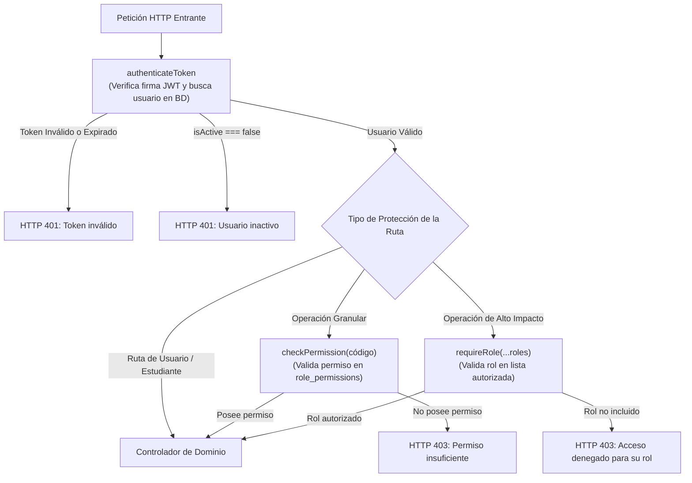

Este documento detalla los mecanismos de seguridad, autenticación y autorización del backend UGD. Explica cómo se protegen las rutas HTTP, el ciclo de vida de los tokens JWT, la arquitectura de **doble identidad** (Usuario vs Doctorando) y la matriz relacional completa de roles y permisos.

---

## 1. Autenticación Basada en JSON Web Tokens (JWT)

El sistema implementa autenticación sin estado (*stateless*) mediante tokens JWT firmados simétricamente con el algoritmo HMAC SHA-256 utilizando la clave `JWT_SECRET`.

### 1.1 Estructura del Payload del Token
Al emitir un token en `/api/auth/login`, `/api/auth/admin-login` o `/api/auth/activar-cuenta`, el backend incluye:

```json
{
  "userId": "c1f7b8e2-4d3a-4e2b-9a1c-5d8f3b2a1c4e",
  "role": "ANALISTA_PROCESOS",
  "iat": 1773489600,
  "exp": 1773576000
}
```

* **`userId`**: Identificador único (UUID) del usuario en la tabla `users`.
* **`role`**: Código programático del rol (`DESARROLLADOR`, `DIRECTOR`, `ANALISTA_PROCESOS`, `ANALISTA_TECNICO`, `ESTUDIANTE`).
* **`exp`**: Tiempo de expiración configurado por defecto en 24 horas (`JWT_EXPIRES_IN=24h`).

### 1.2 Extracción Dual del Token
El middleware `authenticateToken` en `src/middleware/auth.middleware.ts` admite dos mecanismos de envío del token:
1. **Cabecera HTTP estándar:** `Authorization: Bearer <token>` (utilizado por peticiones REST desde Axios, Fetch o cURL).
2. **Query Parameter:** `?token=<token>` (imprescindible para conexiones `EventSource` de Server-Sent Events desde navegadores que no admiten cabeceras personalizadas).

---

## 2. Los Tres Niveles de Middlewares de Seguridad



### 2.1 `authenticateToken`
- Extrae el token, verifica la firma con `JWT_SECRET`.
- Consulta inmediatamente al usuario en PostgreSQL:
  ```typescript
  const user = await prisma.user.findUnique({
    where: { id: decoded.userId },
    include: { role: { include: { permissions: { include: { permission: true } } } } }
  });
  ```
- **Invalidación instantánea:** Si el usuario fue desactivado (`isActive === false`) o eliminado tras la emisión del token, la petición se deniega inmediatamente sin esperar a que el token expire.
- Inyecta `req.user` con su rol y array de códigos de permisos.

### 2.2 `checkPermission(permissionCode)`
- Valida si el array de permisos asociados al rol del usuario en la base de datos contiene el código especificado (ej. `USUARIOS_VER`, `PROCESOS_CREAR`).

### 2.3 `requireRole(...allowedRoles)`
- Restringe operaciones administrativas de alta sensibilidad (reprogramar citas, eliminar representantes, descargar backups) a roles explícitamente autorizados (ej. `requireRole("DESARROLLADOR", "DIRECTOR")`).

---

## 3. Matriz RBAC: Roles y Permisos en Base de Datos

El sistema cuenta con **5 roles** y **15 permisos atómicos**:

### 3.1 Definición de Roles

| Código de Rol (`code`) | Nombre Descriptivo | Alcance Operativo |
| :--- | :--- | :--- |
| **`DESARROLLADOR`** | Desarrollador | Acceso absoluto a desarrollo, diagnósticos, usuarios, respaldos y configuración. |
| **`DIRECTOR`** | Director de Doctorados | Acceso administrativo completo a gestión funcional, citas, reportes y respaldos. |
| **`ANALISTA_PROCESOS`** | Analista de Procesos | Gestión operativa de citas presenciales, reasignaciones y representantes UGD. |
| **`ANALISTA_TECNICO`** | Analista Técnico | Monitoreo técnico de citas, disponibilidad y diagnóstico de servicios. |
| **`ESTUDIANTE`** | Estudiante Doctorando | Autoservicio: consulta de disponibilidad, agendamiento de citas y cancelación de turnos propios. |

### 3.2 Matriz Completa de Permisos

| Permiso (`code`) | Categoría | DESARROLLADOR | DIRECTOR | ANALISTA_PROCESOS | ANALISTA_TECNICO | ESTUDIANTE |
| :--- | :--- | :---: | :---: | :---: | :---: | :---: |
| `USUARIOS_VER` | Usuarios | <Permit /> | <Permit /> | <Permit /> | <Permit /> | <Deny /> |
| `USUARIOS_CREAR` | Usuarios | <Permit /> | <Permit /> | <Deny /> | <Deny /> | <Deny /> |
| `USUARIOS_EDITAR` | Usuarios | <Permit /> | <Permit /> | <Deny /> | <Deny /> | <Deny /> |
| `USUARIOS_ELIMINAR` | Usuarios | <Permit /> | <Permit /> | <Deny /> | <Deny /> | <Deny /> |
| `PROCESOS_VER` | Procesos | <Permit /> | <Permit /> | <Permit /> | <Permit /> | <Permit /> |
| `PROCESOS_CREAR` | Procesos | <Permit /> | <Permit /> | <Permit /> | <Deny /> | <Deny /> |
| `PROCESOS_EDITAR` | Procesos | <Permit /> | <Permit /> | <Permit /> | <Permit /> | <Deny /> |
| `PROCESOS_ELIMINAR` | Procesos | <Permit /> | <Permit /> | <Permit /> | <Deny /> | <Deny /> |
| `ESTUDIANTES_VER` | Estudiantes | <Permit /> | <Permit /> | <Permit /> | <Deny /> | <Permit /> |
| `ESTUDIANTES_CREAR` | Estudiantes | <Permit /> | <Permit /> | <Deny /> | <Deny /> | <Deny /> |
| `ESTUDIANTES_EDITAR` | Estudiantes | <Permit /> | <Permit /> | <Deny /> | <Deny /> | <Deny /> |
| `CONFIGURACION_VER` | Configuración | <Permit /> | <Permit /> | <Deny /> | <Deny /> | <Deny /> |
| `CONFIGURACION_EDITAR` | Configuración | <Permit /> | <Permit /> | <Deny /> | <Deny /> | <Deny /> |
| `TECNICO_ACCESO` | Técnico | <Permit /> | <Deny /> | <Deny /> | <Permit /> | <Deny /> |
| `TECNICO_GESTION` | Técnico | <Permit /> | <Deny /> | <Deny /> | <Deny /> | <Deny /> |

---

## 4. Ciclo de Doble Identidad (User vs Doctorando)

Una de las decisiones arquitectónicas clave del backend es la separación entre la **Identidad de Autenticación (`User`)** y el **Expediente Académico (`Doctorando`)**:

```text
[Padrón Oficial UCE (doctorandos)] ──(Pre-cargado con 550+ docentes becarios)──> userId: NULL
                                                                                       │
                      1. Verificación no destructiva (cédula + correo)                 │
                      2. Definición de contraseña en /api/auth/activar-cuenta          ▼
[Cuenta de Autenticación (users)] ◄──────────────────── Vinculación 1:1 ──────────────┘
```

1. **Estado Pre-registrado:** Los doctorandos constan en la tabla `doctorandos` con su cédula, nombres, correo institucional, facultad y carrera, pero con `userId = null`. No pueden iniciar sesión hasta activar su cuenta.
2. **Activación de Cuenta (`POST /api/auth/activar-cuenta`):**
   - El estudiante ingresa cédula y correo.
   - El sistema valida que figure en nómina y que `userId` sea nulo.
   - Crea un registro en `users` con rol `ESTUDIANTE` y contraseña hasheada con bcrypt (salt 10).
   - Actualiza el campo `doctorandos.userId` vinculando ambas entidades en una sola transacción atómica.

---

## 5. Estructura de Cuentas de Prueba para Desarrollo Local

Para pruebas de desarrollo local tras ejecutar `bun run db:seed`, se generan perfiles base con contraseñas temporales parametrizables en el archivo de sembrado local:

| Rol | Correo de Ejemplo | Estado de Credencial | Perfil / Alcance |
| :--- | :--- | :--- | :--- |
| **`DESARROLLADOR`** | `desarrollador.demo@uce.edu.ec` | `••••••••••••` | Entorno de desarrollo local |
| **`DIRECTOR`** | `director.demo@uce.edu.ec` | `••••••••••••` | Dirección UGD (pruebas funcionales) |
| **`ANALISTA_PROCESOS`** | `analista.procesos@uce.edu.ec` | `••••••••••••` | Atención de trámites y citas |
| **`ANALISTA_TECNICO`** | `analista.tecnico@uce.edu.ec` | `••••••••••••` | Diagnóstico y monitoreo técnico |
| **`ESTUDIANTE`** | `doctorando.demo@uce.edu.ec` | `••••••••••••` | Autoservicio y agendamiento |

<Callout type="warn" title="Buenas Prácticas de Despliegue y Seguridad">
  Ninguna credencial ni secreto se expone en código fuente. En entornos de staging y producción:
  * Las contraseñas temporales se reemplazan por hashes generados dinámicamente o por mecanismos de federación institucional.
  * Todas las credenciales maestras y firmas criptográficas se inyectan estrictamente a través de variables de entorno protegidas (`.env` excluido del control de versiones).
</Callout>
