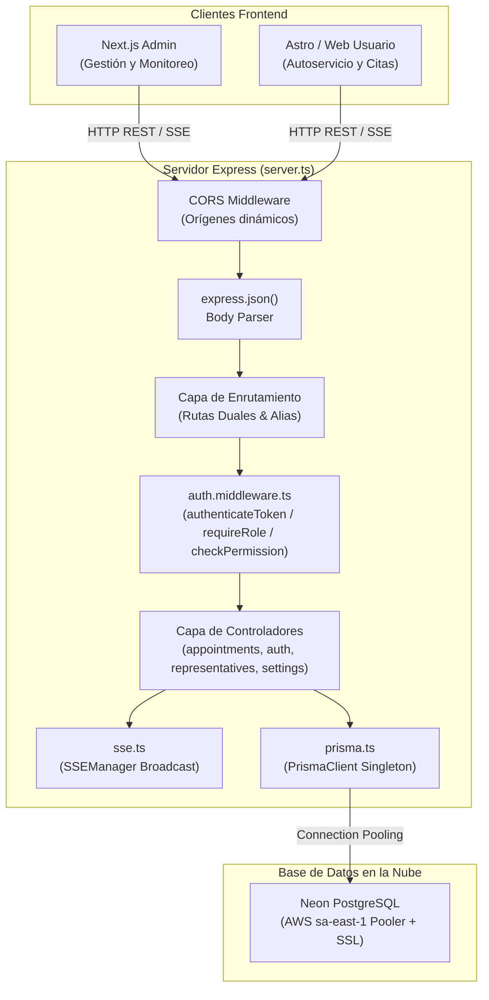

Este documento detalla la arquitectura técnica del backend de la **Unidad de Gestión de Doctorados (UGD)**. Está diseñado para que los ingenieros de software comprendan de forma inmediata la topología del servicio, cómo fluyen las peticiones HTTP y cómo opera la capa de persistencia relacional en la nube.

---

## 1. Visión General de la Arquitectura

El backend opera como una **API REST desacoplada y sin estado (stateless)** complementada con un canal de transmisión unidireccional en tiempo real basado en **Server-Sent Events (SSE)**.



---

## 2. Tecnologías Principales y Versiones

- **Runtime de Ejecución:** [Bun](https://bun.sh/) v1.2+ (con compatibilidad garantizada para Node.js 20+ en despliegues tradicionales) utilizando TypeScript nativo y módulos ECMAScript (`"type": "module"`).
- **Framework Web:** `express` **v5.2.1**, que integra soporte nativo para funciones asíncronas sin necesidad de envolver controladores en bloques `asyncHandler`.
- **Capa ORM:** `prisma` y `@prisma/client` **v6.4.0**.
- **Autenticación y Criptografía:** `jsonwebtoken` v9.0.3 y `bcryptjs` v3.0.3 (con 10 rondas de salt para hasheo irreversible de credenciales).
- **Gestión de Entorno:** `dotenv` v17.4.2.
- **CORS:** `cors` v2.8.6 con resolución dinámica de orígenes permitidos y soporte de preflight.

---

## 3. Enrutamiento con Prefijo Dual y Alias de Compatibilidad

Para garantizar la interoperabilidad con frontends desarrollados en diferentes fases del proyecto, el servidor Express (`src/server.ts`) expone un esquema de **montaje dual** y **alias semánticos**:

### 3.1 Soporte de Prefijo Dual (`/api/*` y `/*`)
Cualquier endpoint puede ser consumido con o sin el prefijo `/api`:
- Ejemplo 1: `POST /api/auth/login` y `POST /auth/login` ejecutan exactamente el mismo controlador.
- Ejemplo 2: `GET /api/appointments/mis-citas` y `GET /appointments/mis-citas` son equivalentes.

### 3.2 Tabla de Alias de Compatibilidad

| Módulo de Dominio | Ruta Canónica | Alias de Compatibilidad | Archivo de Rutas |
| :--- | :--- | :--- | :--- |
| **Representantes UGD** | `/api/representatives` | `/api/personal-ugd`, `/api/labs`, `/representatives`, `/personal-ugd`, `/labs` | `src/routes/representatives.routes.ts` |
| **Citas Presenciales** | `/api/appointments` | `/api/citas`, `/api/reservas`, `/appointments`, `/citas`, `/reservas` | `src/routes/appointments.routes.ts` |
| **Autenticación** | `/api/auth` | `/auth` | `src/routes/auth.routes.ts` |
| **Usuarios** | `/api/users` | `/users` | `src/routes/users.routes.ts` |
| **Configuración** | `/api/settings` | `/settings` | `src/routes/settings.routes.ts` |
| **Procesos** | `/api/procesos` | — | `src/routes/procesos.routes.ts` |
| **Técnico** | `/api/tecnico` | — | `src/routes/tecnico.routes.ts` |

---

## 4. Variables de Entorno (`.env`)

Ubicación del archivo: `express-backend-api/.env`

```bash
# Puerto TCP de escucha del servidor Express (por defecto 3000)
PORT=3000

# Cadena de conexión JDBC / PostgreSQL (Ejemplo con Connection Pooling y TLS requerido)
DATABASE_URL="postgresql://<DB_USER>:<DB_PASSWORD>@<DB_HOST>-pooler.<REGION>.aws.neon.tech/<DB_NAME>?sslmode=require"

# Clave secreta simétrica HMAC SHA-256 para firma y validación de JSON Web Tokens (mínimo 64 caracteres)
JWT_SECRET="<GENERAR_CLAVE_ALEATORIA_ALTA_ENTROPIA_64_CHARS>"

# Tiempo de vida de los tokens emitidos (formato zeit/ms, ej. 24h, 7d)
JWT_EXPIRES_IN="24h"

# Orígenes CORS permitidos separados por comas
CORS_ORIGIN="http://localhost:3000,http://localhost:4321,http://localhost:3001,https://app.tu-dominio.edu.ec"
```

<Callout type="warn" title="Manejo de Credenciales Sensibles">
  El archivo `.env` nunca debe commitearse al repositorio Git (`.gitignore` activo). En entornos de producción o staging, debe reemplazarse `JWT_SECRET` por una clave de alta entropía generada criptográficamente (mínimo 64 caracteres).
</Callout>

---

## 5. Conexión a Neon PostgreSQL

La base de datos relacional opera sobre la nube Serverless de **NeonTech** en la región `aws-sa-east-1` (São Paulo):

* **Connection Pooling:** La URL de conexión incluye `-pooler`, lo que canaliza las conexiones a través del pooler integrado de PgBouncer. Esto previene el agotamiento de sockets concurrentes durante picos de agendamiento.
* **Seguridad SSL:** El parámetro `sslmode=require` impone cifrado obligatorio en tránsito para todas las consultas Prisma.
* **Prisma Singleton:** En `src/lib/prisma.ts` se implementa el patrón singleton para reutilizar la conexión en entornos con Hot Reload (`globalForPrisma`).
