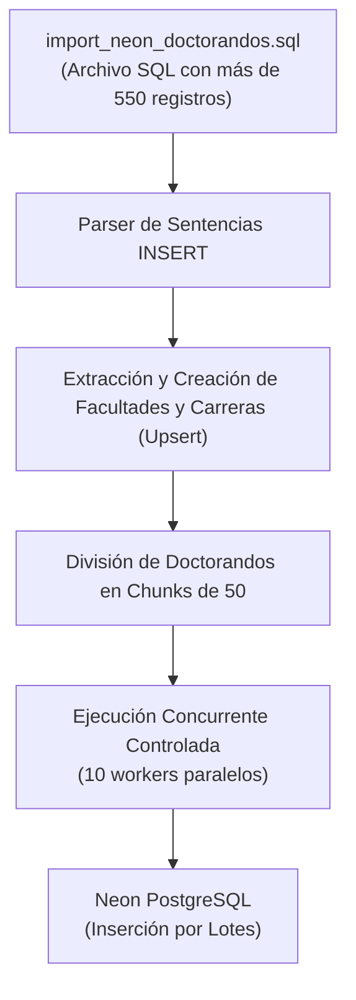

El backend UGD incluye una arquitectura de sembrado (*seeding*) dividida en dos scripts especializados para garantizar rapidez y robustez tanto en desarrollo local como en despliegues sobre bases de datos en la nube.

---

## 1. Arquitectura de los Seeders

```text
prisma/
├── seed.ts             # 1. Sembrado del Sistema Base (Roles, Permisos, Usuarios y Settings)
├── seed-doctorandos.ts # 2. Carga Masiva Concurrente (Padrón Oficial UCE de más de 550 doctorandos)
└── data/
    └── import_neon_doctorandos.sql # Sentencias SQL con la nómina histórica de la UGD
```

---

## 2. Seeder 1: Sistema Base (`seed.ts`)

Se ejecuta mediante:
```bash
bun run db:seed
```

Este script es **idempotente** (utiliza `upsert` y validaciones previas para evitar duplicidad si se ejecuta múltiples veces). Realiza las siguientes operaciones:

1. **Catálogo de Permisos:** Inserta los 15 permisos atómicos del sistema (`USUARIOS_VER`, `PROCESOS_CREAR`, `ESTUDIANTES_VER`, etc.).
2. **Roles del Sistema:** Inserta los 5 roles (`DESARROLLADOR`, `DIRECTOR`, `ANALISTA_PROCESOS`, `ANALISTA_TECNICO`, `ESTUDIANTE`).
3. **Matriz RBAC (`role_permissions`):** Vincula a cada rol sus permisos correspondientes según la matriz oficial.
4. **Usuarios de Prueba (Entorno de Desarrollo):**
   - **Administrador / Desarrollador:** Perfil técnico con rol `DESARROLLADOR` para pruebas y configuración.
   - **Director UGD:** Perfil funcional con rol `DIRECTOR` para validación de procesos.
   - **Analistas y Doctorando Demo:** Cuentas con credenciales temporales generadas dinámicamente mediante hash bcrypt para validación de flujos.
5. **Representantes UGD Iniciales:** Inserta los analistas de atención presencial iniciales.
6. **Parámetros por Defecto (`system_settings`):** Configura `start_hour: "08:00"`, `end_hour: "16:00"`, `slot_interval: "30"` y `system_status: "online"`.

---

## 3. Seeder 2: Padrón Oficial de Doctorandos (`seed-doctorandos.ts`)

Se ejecuta mediante:
```bash
bun run db:seed:doctorandos
```

La nómina histórica de la Universidad Central del Ecuador contiene más de **550 docentes becarios**, decenas de facultades y carreras. Para cargar este volumen en una base de datos Serverless en la nube (Neon PostgreSQL) sin agotar conexiones ni generar *deadlocks*, el script implementa un pipeline concurrente optimizado:



### Características Técnicas del Cargador Masivo:
* **Batching:** Agrupa las inserciones en paquetes de 50 registros por lote.
* **Control de Concurrencia:** Limita a 10 transacciones paralelas simultáneas para respetar el límite de conexiones del pooler de Neon.
* **Estado Pre-registrado:** Todos los doctorandos se insertan con `userId: null`, listos para que los estudiantes ejecuten el flujo de activación de cuenta (`/api/auth/activar-cuenta`).

---

## 4. Ejecución Completa (`db:seed:all`)

Para inicializar una base de datos limpia de principio a fin en una sola instrucción:

```bash
bun run db:seed:all
```

Este comando encadena secuencialmente `seed.ts` seguido de `seed-doctorandos.ts`.
