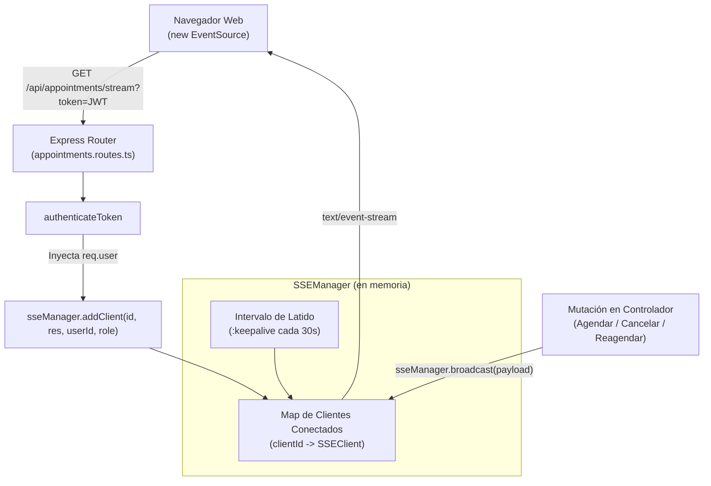

Este documento detalla la arquitectura de comunicación reactiva en tiempo real implementada mediante **Server-Sent Events (SSE)** en el backend UGD.

---

## 1. Justificación Arquitectónica: SSE vs WebSockets

Para el caso de uso del sistema UGD (monitoreo de ventanilla en vivo, actualización inmediata de disponibilidad y cancelaciones reactivas), se seleccionó **Server-Sent Events (SSE)** sobre WebSockets por las siguientes ventajas:

1. **Protocolo HTTP Nativo:** Opera sobre conexiones HTTP estándar con `Content-Type: text/event-stream`, atravesando sin fricciones balanceadores de carga, firewalls institucionales y proxies inversos.
2. **Reconexión Automática:** El API nativo de los navegadores (`EventSource`) implementa de forma transparente la lógica de reintento ante caídas temporales de red.
3. **Eficiencia en Recursos:** Es un canal unidireccional (servidor a cliente), eliminando el consumo de memoria asociado al duplexing de WebSockets cuando los clientes ya se comunican mediante peticiones REST estándar.

---

## 2. Arquitectura de `SSEManager` (`src/lib/sse.ts`)

La gestión de clientes conectados se centraliza en la clase `SSEManager`:



---

## 3. Conexión al Stream de Eventos

<ApiEndpoint method="GET" path="/api/appointments/stream" auth="Bearer JWT o ?token=" />

Abre un canal persistente de eventos para el cliente.

### 3.1 Cabeceras de Respuesta del Servidor
```http
HTTP/1.1 200 OK
Content-Type: text/event-stream
Cache-Control: no-cache
Connection: keep-alive
X-Accel-Buffering: no
```

### 3.2 Envío del Token de Autenticación
Dado que la especificación estándar del navegador `new EventSource(url)` no permite inyectar cabeceras `Authorization` personalizadas, el middleware `authenticateToken` soporta recibir el JWT por parámetro de consulta:
```javascript
const eventSource = new EventSource("http://localhost:3000/api/appointments/stream?token=" + userToken);
```

---

## 4. Catálogo de Eventos Emitidos

Cuando un controlador ejecuta una acción que altera las citas, invoca `sseManager.broadcast`:

### 4.1 Cita Agendada (`appointment_created`)
Se emite cuando un estudiante reserva una o más franjas horarias:
```text
event: appointment_created
data: {"appointmentId":45,"representativeId":1,"date":"2026-03-25","slots":["08:30","09:00"]}
```

### 4.2 Cita Cancelada (`appointment_cancelled`)
Se emite cuando un estudiante o un administrador cancela una cita:
```text
event: appointment_cancelled
data: {"appointmentId":45,"representativeId":1,"date":"2026-03-25","startTime":"08:30"}
```

### 4.3 Cita Reagendada (`appointment_rescheduled`)
Se emite cuando un analista administrativo modifica la fecha u hora de un turno:
```text
event: appointment_rescheduled
data: {"appointmentId":45,"newDate":"2026-03-26","newStartTime":"10:00"}
```

---

## 5. Prevención de Timeouts (Keep-Alive Heartbeat)

Para evitar que servidores intermedios, firewalls o proxies de Vercel/Nginx cierren la conexión por inactividad, `SSEManager` ejecuta un temporizador interno cada **30 segundos** que envía un comentario SSE inocuo:
```text
:keepalive
```
El navegador procesa este mensaje como un comentario de protocolo sin disparar eventos en el frontend, manteniendo el socket TCP activo indefinidamente.
