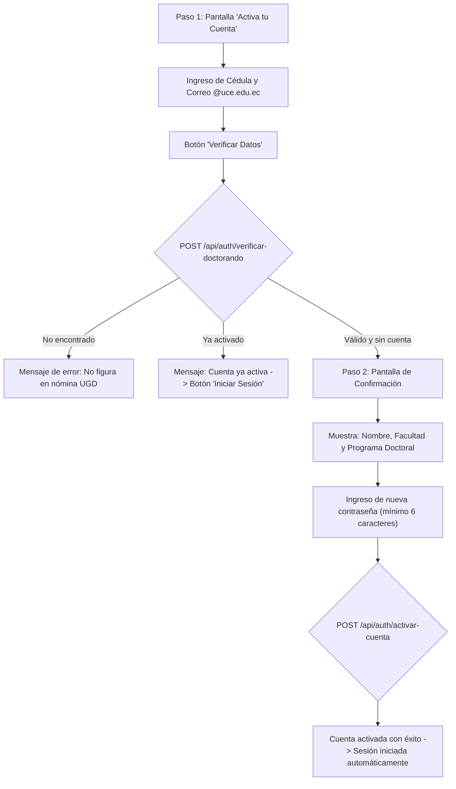

Este documento detalla los flujos de interacción que debe implementar el **Frontend de Usuarios** para garantizar una experiencia de autoservicio guiada, clara y libre de fricciones.

---

## 1. Flujo de Activación de Cuenta Oficial UGD

Los estudiantes que ya figuran en la nómina académica de la UCE no requieren un registro tradicional desde cero; activan su cuenta oficial validando su identidad:

### Directrices de UX para la Activación
- **Validación Temprana:** Comprobar en tiempo real que el correo ingresado termine con el dominio `@uce.edu.ec`.
- **Sensación de Pertenencia:** Mostrar el nombre oficial y la facultad del estudiante una vez verificado para transmitir confianza antes de que ingrese su contraseña.

---

## 2. Flujo de Agendamiento de Citas Presenciales

El proceso de reserva de turno se organiza en tres pasos progresivos:

### Paso 1: Selección del Motivo y del Representante
- El usuario selecciona el trámite presencial que desea realizar:
  - *Entrega o firma de informe doctoral*
  - *Consulta sobre convenio o adenda de financiamiento*
  - *Proceso de devengamiento institucional*
  - *Asesoría técnica general*
- Elige el módulo o analista asignado (o la opción "Cualquier ventanilla disponible").

### Paso 2: Calendario y Grilla Horaria
- **Calendario:** Permite seleccionar la fecha deseada:
  - Se deshabilitan automáticamente días pasados, fines de semana y feriados universitarios.
- **Grilla de Turnos (Slots de 30 minutos):**
  - Al hacer clic en un día, se realiza la consulta a `GET /api/representatives/disponibilidad?fecha=YYYY-MM-DD&representative_id=X`.
  - Los bloques se presentan en tarjetas seleccionables:
    - *08:00 - 08:30 (Disponible)*
    - *08:30 - 09:00 (Disponible)*
    - *09:00 - 09:30 (Ocupado / No disponible)*
  - El usuario puede marcar **uno o varios bloques contiguos** si su trámite requiere mayor tiempo (ej: 1 hora = 2 bloques).

### Paso 3: Confirmación y Envío
- Resumen visual de la reserva: fecha, hora de inicio y fin, representante y ventanilla asignada.
- Al pulsar *"Confirmar Cita"*, se ejecuta `POST /api/appointments/agendar`.
- Se presenta pantalla de confirmación con el ticket digital del turno y opción de guardar en Google Calendar / Apple Calendar.

---

## 3. Panel "Mis Citas" y Cancelación Autónoma

- Muestra las citas agendadas por el estudiante ordenadas cronológicamente.
- Permite al estudiante cancelar una cita pendiente con un clic mediante `DELETE /api/appointments/citas/:id`.
- Muestra un aviso de confirmación: *"¿Estás seguro de cancelar tu cita del viernes 20 de noviembre a las 09:00? El horario quedará disponible para otro estudiante."*
